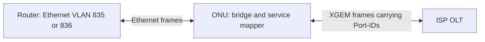

# DEI XGS-PON setup

A configuration-driven setup and repair tool for DEI Fiber connections using a
WAS-110-compatible module with 8311 community firmware v2.8.3. It builds one
self-contained BusyBox shell installer, configured through one private TOML file.

The tool selects either Internet VLAN 835 or 836, discovers the selected service's
current mapper and GEM ports, and repairs supported VLAN and encryption settings.
It can also prepare ONU identity, management settings, a supported MIB profile,
persistent storage, and the guide's conditional UNI-0x0205 library patch.

Setup is based on the [DEI Fiber guide](https://rg.spes.gr/dei-fiber-8311/) and the
[8311 firmware project](https://github.com/djGrrr/8311-was-110-firmware-builder).
This repository does not contain vendor firmware or patched library binaries.

## Validation status

Manual corrections on the original test connection restored Internet access on
VLAN 835: downstream encryption was enabled on its actual GEM ports, and an
incorrect upstream VLAN 835-to-836 rewrite was corrected.

The automated installer, VLAN 836 conversion, and phased reboot workflow have
been tested with offline mocks. They have not yet been validated as a complete
installation or reboot cycle on physical hardware. The tests never contact an
ONT, router, or ISP.

Discovery avoids fixed GEM ranges and hardware bridge-port numbers. Before an
encryption write, the tool reads attribute 1 (Port-ID) of OMCI class 268 at the
candidate instance ID and verifies that it matches the selected driver GEM. It
supports the equal-ID layout observed on the original line; it does not guess a
different instance ID if that check fails. The new readback guard also needs
physical validation. Support is limited to recognized configuration patterns;
this is not a universal ONT provisioning tool.

## What GEMs are and why they are needed

**GEM** means **GPON Encapsulation Method**: a way to carry traffic such as
Ethernet frames over a passive optical network. XGS-PON uses the related **XGEM**
(XG-PON Encapsulation Method) format; this firmware's commands and interface
names still use `GEM`.
When this README refers to "a GEM", it usually means a **GEM port**: a logical
traffic flow identified by a Port-ID, rather than a physical socket or a TCP/UDP
port.

Your router sends Ethernet frames to the ONU module. The module encapsulates
them into XGEM frames for transmission to the ISP's optical line terminal
(OLT), and reconstructs Ethernet frames in the reverse direction. Port-IDs let
the PON distinguish logical flows carried over shared optical infrastructure.
This supports separate services and traffic priorities without requiring a
separate fibre for each flow. Ethernet encapsulation and Port-ID behavior are
specified in [ITU-T G.9807.1](https://www.itu.int/rec/T-REC-G.9807.1), clauses
C.9.4.1 and C.6.1.5.8.



| Term | Role in this setup |
| --- | --- |
| VLAN ID | Identifies the Ethernet service presented to the router |
| GEM Port-ID | Identifies a logical flow on the PON side |
| `pmapper` | Maps traffic priorities to the service's provisioned GEMs |

These identifiers serve different purposes: VLAN 835 does not imply GEM 835,
and one Internet service can use several GEMs for different priorities. The OLT
provisions those ports and their service relationships through OMCI, the ONU
management protocol. See [ITU-T G.988](https://www.itu.int/rec/T-REC-G.988),
sections 9.2.3 and 9.3.10.

Correct mapping and encryption settings are both needed for traffic to pass.
A Port-ID identifies a flow; it does not itself encrypt its contents. O5 confirms
PON activation, but data GEMs can still be misconfigured. On the original test
connection, packets arrived on Internet GEMs but accumulated key errors until
their downstream encryption setting was corrected. The module firmware handles
the actual encryption and key exchange; the repair script restores the required
configuration. This explains why management access or O5 can work while DHCP or
ordinary Internet traffic fails. Correcting only one GEM can also restore part
of the service while traffic on other GEMs still fails.

## GEM discovery and diagnostic output

The installer reports **observed GEM interfaces** separately from the **selected
Internet service's GEMs**. It does not scan a fixed numeric range. It follows the
configured VLAN to one supported mapper, reads that mapper's current members,
and verifies each selected GEM's driver ID, traffic type, direction, multicast
flag, and encryption setting before allowing changes.

This distinction mattered on the original connection: the guide's helper scanned
only IDs 1100–1300, while the module had service GEMs 1072–1087. Its Internet
mapper used 1084–1087. Those numbers describe that observed allocation; they are
not defaults or limits in this tool. An OLT may reuse or change IDs during startup
or reprovisioning, and the selected IDs need not be contiguous.

**Sample output only**; the IDs and mapper below are installation-specific:

```text
Observed numeric GEM interfaces (all services; not an apply target): 1072 1073 1074 1075 1076 1077 1078 1079 1080 1081 1082 1083 1084 1085 1086 1087 2046
VLAN 835: mapper=pmapper1 rules=fixed GEMs=1084 1085 1086 1087 target-encryption=3 normalize=true
Discovery source: current mapper membership; no fixed GEM range or assumption that IDs are contiguous.
GEM 1084: role=unicast-data driver-id=1084 traffic-type=0 direction=3 multicast=0 encryption=3 target-encryption=3
GEM 1085: role=unicast-data driver-id=1085 traffic-type=0 direction=3 multicast=0 encryption=3 target-encryption=3
GEM 1086: role=unicast-data driver-id=1086 traffic-type=0 direction=3 multicast=0 encryption=3 target-encryption=3
GEM 1087: role=unicast-data driver-id=1087 traffic-type=0 direction=3 multicast=0 encryption=3 target-encryption=3
```

The inventory can include GEMs for other services or roles. It never authorizes
writing to those GEMs. If service selection is unavailable or ambiguous, the
output reports the observed IDs and the reason discovery stopped. Unsupported
selected members are described, but no repair is authorized. Port-ID and OMCI
instance ID are distinct fields: a failed or mismatched class-268 attribute-1
read prevents encryption writes. Only a successful, unambiguous two-byte hex
reply is accepted, such as `attr_data=043C` or `attr_data=04 3C` for Port-ID 1084.
Arbitrary instance-ID mappings remain unsupported.

The worker rechecks the service's configuration, mapper identity and GEM
membership around vendor reads and immediately before mutations. A changed
service stops the operation; the watcher must observe it afresh before retrying.
These checks reduce reprovisioning races, but cannot make separate vendor calls
atomic with the OLT's provisioning activity.

`check` and `diagnose` print these findings without writing a persistent log. `install` and
`patch-library` retain sanitized diagnostic findings and decisions in the private
`/ptconf/8311/install.log`, including blocked-operation recommendations. The audit
rotates around 128 KiB into `install.log.old`. It contains no raw configuration or
unfiltered OMCI log contents.

A one-shot runtime repair records its discovered GEMs in `dei835.log` even when
all settings already match. The watcher records complete snapshots when stable
mappings appear or change, and reports changed blocked-discovery details. It does
not write an identical full discovery report on every unchanged poll. Runtime
logs are private, and symlinks or special files at managed log paths are refused.

## Build and configure

Development uses Python **3.15.2**, selected by `.python-version`, `uv` 0.13.7 or
newer, and a host installation of BusyBox. The locked development environment
provides the linters and formatters, including ShellCheck; they do not need
separate system installations. The module itself still runs BusyBox shell and
does not need Python, `uv`, or development tools.

After installing `uv` and BusyBox on your development machine, bootstrap the
locked environment and install the local Git commit hooks:

```sh
make dev
make build
```

The underlying build command is:

```sh
uv run --locked python scripts/build_installer.py
```

Build output goes into ignored `dist/`:

- `dei-pon-install.sh`: the self-contained installer.
- `dei-pon.toml`: the configuration template.
- `dei-pon-setup.zip`: the distributable package.
- `SHA256SUMS`: artifact checksums.

Keep your actual configuration outside the tracked example:

```sh
mkdir -p local
test -e local/dei-pon.toml || cp config/dei-pon.example.toml local/dei-pon.toml
chmod 600 local/dei-pon.toml
```

Edit `local/dei-pon.toml`. Both `local/` and `config/dei-pon.toml` are ignored.
The ONU serial identifies your installation; do not commit a populated
configuration or paste its contents into an issue.

The parser accepts a deliberately small TOML subset: the documented sections and
keys, quoted strings without escapes, nonnegative decimal integers, booleans, and
comments. Unknown or repeated keys and sections, arrays, dotted keys, backslash
escapes, and multiline strings are rejected. Configuration is parsed as data,
never sourced as shell code.

| Section | Purpose |
| --- | --- |
| `internet` | Service VLAN, encryption key ring, and recognized VLAN repairs |
| `watcher` | Enable monitoring and set its polling interval |
| `library_patch` | Explicit binary-patch opt-in and assessment/application policy |
| `onu` | Serial, OMCC version, identity fields, and MIB profile |
| `management` | Module IPv4 settings and failsafe startup delay |
| `storage` | Persistent-root policy |

The example selects VLAN 835 and downstream-only encryption, preserves blank
identity and management fields, and retains the currently selected MIB. It
requests OMCC version `0xA0`, a 30-second failsafe delay, and hook-only VLAN mode.
Review the `check` output for settings that would change.

### Configuration reference

Edit the existing sections in `local/dei-pon.toml`; do not append a second copy
of a section. Missing optional keys use the defaults below. An empty string
`""` in an identity or management-address field means **keep the current firmware
value**, not clear it. Numeric and boolean defaults still take effect when their
keys are omitted. `schema_version` is the one required key.

#### File format

| Setting | Value | Meaning |
| --- | --- | --- |
| `schema_version` | `1` (required) | Selects this tool's configuration schema. It is not the module's firmware version. |

#### `[internet]`

| Setting | Default | Meaning and accepted values |
| --- | --- | --- |
| `vlan` | `835` | Selects the Internet service to maintain: `835` for the dynamic-address service or `836` for the static-IP service. In the intended tagged setup, the router uses the same VLAN and DHCP. |
| `encryption_key_ring` | `3` | Target encryption mode for the selected service's discovered unicast GEMs: `3` for downstream only, or `1` for both directions. This is a mode selector, not an encryption key. The verified connection uses `3`. |
| `normalize_vlan` | `true` | Allows correction of the specifically recognized VLAN rewrite/untagged-service patterns. `false` leaves those VLAN rules alone; encryption maintenance remains independently configured. It never permits arbitrary rule or bridge-port rewrites. |

There is no configured GEM range: the tool discovers the selected mapper and its
current members. See [GEM discovery and diagnostic output](#gem-discovery-and-diagnostic-output).
If you turn normalization off, an existing translation or legacy untagged mapping
remains in place. Verify what that mapping expects from the router; selecting a
VLAN in TOML alone does not convert an untagged service into a tagged one.

#### `[watcher]`

| Setting | Default | Meaning and accepted values |
| --- | --- | --- |
| `enabled` | `true` | Keeps a background watcher checking for supported configuration resets. With `false`, a successful installation applies runtime settings once, but automatic repair after boot or reprovisioning is disabled. |
| `interval_seconds` | `10` | Time between watcher checks; integer `5`–`300`. A new or changed mapping must be observed consistently before writes, so initial repair can require multiple polling cycles. |

If you disable the watcher, rerun the installer when provisioning resets the
working settings. A disabled watcher does not perform a one-shot repair on every
boot. Rerun `install` to start monitoring after changing it back to `true`; an
already-exited watcher cannot notice that file change. The firmware still
performs packet encryption and key exchange itself.

#### `[library_patch]`

| Setting | Default | Meaning and accepted values |
| --- | --- | --- |
| `enabled` | `false` | Explicit permission to apply the optional `libponnet` UNI-mapping workaround when it is applicable. Set `true` only after reviewing the reported need. It does not enable GEM encryption; that is controlled by `internet.encryption_key_ring`. |
| `policy` | `"auto"` | `"auto"` allows conditional assessment/application, but application still requires `enabled = true` and all safety checks. `"never"` forbids applying the binary patch even if enabled. |

These settings do not remove an already-installed patch. O5 alone does not
establish that the workaround is needed, and opting in does not bypass library
hash, MIB, persistent-storage, or maintenance checks. The
[patch explanation below](#existing-and-fresh-installations) describes the
supported library and the recommendation workflow.

#### `[onu]`

| Setting | Default | Meaning and accepted values |
| --- | --- | --- |
| `serial` | `""` | The PON serial provisioned for your fibre connection, usually found on the ISP ONU's label or optical-status page. Use four vendor letters followed by eight hexadecimal digits. This is not the UDMP serial or an Ethernet/Wi-Fi MAC address. Blank preserves a valid existing serial; a fresh setup needs your actual value. |
| `omcc_version` | `"0xA0"` | The OMCC management-channel compatibility byte reported to the OLT. Accepts `0x82`–`0xBF` and normalizes hexadecimal letters to uppercase, as required by this firmware. Keep the verified `"0xA0"` unless your provider profile requires another supported value. This field cannot be blank. |
| `vendor_id` | `""` | Optional four-character alphanumeric vendor identity. Blank preserves an existing override. When generating the DEI MIB without an override, the tool derives the vendor from the serial's first four characters. |
| `equipment_id` | `""` | Equipment/model identity advertised through OMCI, up to 20 bytes. Blank preserves the current value. Use the identity required by your provisioned device profile. |
| `hardware_version` | `""` | Hardware-revision identity advertised through OMCI, up to 14 bytes. Blank preserves the current value. This is an identity string, not a firmware download/version selector. |
| `mib_profile` | `"preserve"` | `"preserve"` retains the explicitly selected MIB; `"native_1u"` selects the supported native single-Ethernet-UNI template; `"dei_0205"` generates the guide's single-UNI-0x0205 profile. Fresh setup must select a profile explicitly rather than relying on `"preserve"` without an existing MIB. |

The MIB is the model of the ONU's interfaces and capabilities that the OLT
configures through OMCI. Its profile is independent of whether you select VLAN
835 or 836. Changing identity fields while retaining a custom MIB may leave
cached fields inconsistent, so the tool can require an explicit profile before
allowing such a change.

TOML is the installer's input; it does **not** replace the firmware's native MIB
format. `dei_0205` still generates `/ptconf/8311/dei.ini`, while `native_1u` selects
`/etc/mibs/prx300_1U.ini`. When generating the DEI MIB, inherited hardware and
equipment strings follow the firmware's 14/20-byte limits. Truncation is reported
without printing their values or rewriting the original firmware variables.
These limits and the OMCC format follow the
[v2.8.3 firmware getters](https://github.com/djGrrr/8311-was-110-firmware-builder/blob/v2.8.3/files/common/lib/8311.sh).

#### `[management]`

These settings control access to the **stick itself**. They do not assign the
router's Internet address or configure the UDMP's WAN interface. Nonempty address
fields must contain supported unicast IPv4 addresses; IPv6 is not accepted here.

| Setting | Default | Meaning and accepted values |
| --- | --- | --- |
| `ip_address` | `""` | The stick's management IPv4 address. Blank keeps its current address. A change takes effect through the firmware's startup configuration; reconnect at the new address afterward. |
| `netmask` | `""` | The management subnet mask in dotted-decimal form, such as `"255.255.255.0"`. It must be a contiguous, nonzero IPv4 mask. Blank preserves the current mask. |
| `gateway` | `""` | Default gateway for traffic generated by the stick's management system, typically your router on the management subnet. This is separate from the ISP gateway learned by the UDMP through DHCP. |
| `ping_ip` | `""` | Target address used by the 8311 firmware's management ping helper when that helper is enabled. It is not a router-side Internet health-check setting. Blank preserves the current target. |
| `failsafe_delay` | `30` | Requested delay in seconds before firmware starts `omcid`, providing a management-access window during boot. Accepts integer `0`–`300`; the BFW variant enforces a 10-second minimum. This is separate from the watcher's polling interval. |

For 8311 v2.8.3, the firmware caps that startup delay at 300 seconds, and its BFW
variant also enforces a 10-second minimum. The default of 30 seconds is within
both variants' bounds. A failsafe file can prevent OMCI startup entirely,
regardless of this delay. See the
[v2.8.3 startup code](https://github.com/djGrrr/8311-was-110-firmware-builder/blob/v2.8.3/mods/common-mods.sh#L56-L65).

#### `[storage]`

| Setting | Default | Meaning and accepted values |
| --- | --- | --- |
| `persistent_root` | `"auto"` | `"auto"` enables/verifies root persistence when the library patch requires it or is already installed; otherwise it retains the current policy. `"enabled"` requests persistence even without that patch. `"preserve"` keeps the current policy and rejects a new required patch if persistence is not already usable. |

Root persistence retains changes in the writable firmware overlay, including the
patched library. It retains other overlay edits too. The tool checks the backing
storage and, when necessary, uses a reboot-surviving marker to verify persistence.
Your TOML and the installed helper scripts are stored separately in `/ptconf/8311`.

### Internet service

Set `vlan` in the existing `[internet]` section:

| VLAN | Service described by the DEI guide | Router WAN mode |
| --- | --- | --- |
| `835` | Dynamic-address Internet | DHCP, tagged VLAN 835 |
| `836` | Fixed-address/static-IP Internet | DHCP, tagged VLAN 836 |

Choose the service provisioned for your line. With the intended native or
normalized tagged setup, the router's WAN VLAN must match the TOML selection.
Selecting 836 still uses DHCP; it does not mean entering a static address on the
router. If normalization is disabled, the existing mapping determines the
router-facing tagging instead.

`encryption_key_ring = 3` enables downstream-only unicast encryption; `1` enables
both directions. The working VLAN-835 connection used `3`. Changes apply only to
the selected service's discovered unicast data GEMs.

With `normalize_vlan = true`, the tool can repair the recognized 835-to-836
rewrite and convert the recognized legacy untagged VLAN-836 mapping into tagged
VLAN-836 service. Native supported passthrough rules are preserved. Ambiguous
mappers or unfamiliar rule combinations cause the repair to stop without
guessing.

### Existing and fresh installations

For an existing installation, blank identity fields preserve current values and
`mib_profile = "preserve"` keeps the existing selected MIB. Management fields also
preserve their current values when blank.

For a fresh module, fill `serial` in the existing `[onu]` section with the serial
of the ISP-provisioned ONU and explicitly choose a profile:

- `native_1u` selects `/etc/mibs/prx300_1U.ini` and aligns both firmware MIB
  selectors. It is rejected when the known UNI-0x0205 binary patch is installed.
- `dei_0205` builds the guide's single-UNI-0x0205 MIB from the exact supported ROM
  template, incorporating the selected identity fields. It uses the guarded
  maintenance workflow when changes require it.

Choose the profile required by your OLT; the tool does not infer it from O5.
Changing identity fields while preserving a custom MIB is rejected when it would
leave cached identity fields inconsistent.

The optional binary patch is tied to exact library hashes:

| Library | MD5 |
| --- | --- |
| Supported stock | `5326f83e22a18929b830adfb82cfc483` |
| Supported patched | `5ddb892fbf0b648479f605d9fddda50c` |

The installer checks the selected UNI layout, library identity, maintenance
state, and persistent storage before applying the single-byte patch. It preserves
a verified stock backup, verifies the changed byte and final hash, and installs
the result through an atomic rename. Unknown binaries are never patched; an
unrecognized checksum establishes unsupported binary contents, not necessarily a
different firmware version. An already patched library is left unchanged, but
setup refuses it with a native UNI-0x0101 MIB or an unverified UNI layout, including
when the profile is `preserve`. Recovery requires explicit review; the tool does
not restore the stock library automatically.

Binary patching requires an explicit opt-in. The default configuration is:

```toml
[library_patch]
enabled = false
policy = "auto"
```

`policy = "auto"` permits assessment; it does not grant permission to write the
binary by itself. `enabled = true` is also required. `policy = "never"` prevents
patching even when the enable flag is true.

The check and installation audit distinguish UNI compatibility failures from GEM
decryption errors. A failure to create `PPTP Ethernet UNI` instance `11@517`
(`0x0205`) can support a recommendation to inspect the UNI compatibility patch.
A matching `pon_net_ifname_get()` error can corroborate that finding. A generic
MIB-reset failure, an API error by itself, O5 alone, or rising GEM key errors does
not establish that this binary patch is needed.

Log entries may be historical. The audit reports bounded, categorized evidence
rather than copying raw log lines, and it does not claim that an old failure is
current. Log evidence never bypasses the exact library hash, selected MIB,
persistence, or maintenance guards, and never selects a different MIB profile
automatically.

The diagnostic scan prioritizes `/tmp/omcid.log` and `/var/log/omcid.log`, then
searches for `*omci*log*` under `/tmp`, `/var`, and `/ptconf` to depth four. It
considers up to 32 matching paths per tree and reads at most 32 distinct plaintext
files, including rotated plaintext logs. Each read is limited to the last 256 KiB
and 1,024 lines. Aliases are deduplicated; compressed files, binary/control-byte
data and paths escaping those trees are excluded. Missing logs are reported as
unavailable; the tool does not turn logging on or treat missing evidence as proof
that no fault exists.

When a supported patch is recommended, review the evidence, change `enabled` to
`true` in your private TOML, and rerun `check` followed by `install` with that
configuration. Required binary changes remain blocked until that opt-in is
present; the tool never enables it automatically.

## Reach the module from your LAN through a UniFi gateway

On the tested UDM-Pro, the WAS-110 management address is `192.168.11.1` on
the untagged SFP+ link. The physical port is `eth9` and Internet service uses
the tagged interface `eth9.835`. For DEI VLAN 835 or 836, put the management
address on the **physical parent interface**. Confirm the SFP+ WAN port under
**UniFi Network → Settings → Internet** and check its Linux interface name with
`ip -d link show type vlan` on the gateway (`eth9.835@eth9` identifies `eth9`
as the parent). Substitute your own parent interface
throughout. Choose a management subnet that does not overlap the LAN, VPNs or
Internet WAN, and an unused address for the gateway on that subnet.

Open an SSH session to the **UniFi gateway's LAN address** as root. The first
command below gives the gateway a connected route to the module. The second
makes traffic forwarded from a LAN client appear to come from `192.168.11.2`,
so the module can reply directly. Run each command once. To check an existing
setup first, use `ip -4 addr show dev eth9` and the same iptables command with
`-C` in place of `-A`. A successful check means the rule already exists.

```sh
ip addr add dev eth9 local 192.168.11.2/24
iptables -t nat -A POSTROUTING -o eth9 -d 192.168.11.0/24 -j SNAT --to 192.168.11.2
```

On the gateway, `ip route get 192.168.11.1` should show `dev eth9` and
`src 192.168.11.2`. Then run `ssh root@192.168.11.1` **from a LAN computer**
to verify forwarding and the return path. If the gateway can reach the module
but the LAN client cannot, check the SNAT rule and the client's UniFi firewall
policy. Restrict management access to trusted clients with that policy. The
example matches the entire management subnet. The PON Wiki uses a
single destination. To use that scope, specify `-d 192.168.11.1/32` in both
the add and delete commands.

To undo the example, remove only the address and rule you added. UniFi OS can
also clear these manual settings on reboot or reprovisioning.

```sh
ip addr delete dev eth9 local 192.168.11.2/24
iptables -t nat -D POSTROUTING -o eth9 -d 192.168.11.0/24 -j SNAT --to 192.168.11.2
```

For an **untagged DHCP or static-IP WAN**, the guide also describes a UniFi
static interface route to `192.168.11.0/24` through the SFP+ WAN. In UniFi
Network 10.4, open **Settings → Policy Engine → New → Create New Route** and
choose a static route with interface forwarding through that WAN. That method
relies on a return path from the module, which 8311 firmware can provide with
its reverse ARP daemon. On tagged or PPPoE WANs the UniFi route targets a
virtual interface, so use the physical-port SNAT procedure above. For the
menu path in your UniFi Network version and the alternative CLI procedure, see
the [static route](https://pon.wiki/guides/accessing-the-ont/#static-route) and
[source NAT](https://pon.wiki/guides/accessing-the-ont/#source-nat) sections of the PON Wiki.

### Restore management access when the UDM-Pro boots

On a **UDM-Pro with UniFi OS 4.x or later**, use a gateway systemd service.
The [boot script](tools/unifi-ont-access.sh) uses the same `eth9`,
`192.168.11.2/24` and destination `192.168.11.0/24` as the manual setup above.
It checks the existing address and SNAT rule before adding either, so you can
enable it while management access is already working. Edit the three settings
at the top of the script if your port or subnet differs.

The [service](tools/unifi-ont-access.service) runs once after the network startup
target and retries after 15 seconds on failure, including when the interface
is still missing. This uses the host systemd available on modern UniFi OS.
The [UniFi Common community project](https://github.com/unifi-utilities/unifi-common)
documents the same host boot mechanism for its general-purpose script runner.

From **your computer**, in the repository root, set `gateway` to your
**UDM-Pro's LAN address or SSH alias** and use its trusted SSH host key:

```sh
gateway=root@10.10.1.1  # Replace with your gateway's LAN address
tar -C tools -cf - unifi-ont-access.sh unifi-ont-access.service |
  ssh -T -a -o StrictHostKeyChecking=yes "$gateway" '
    set -eu
    test -d /run/systemd/system && test -d /data || { echo "Expected a UniFi OS systemd gateway with /data" >&2; exit 1; }
    install -d -m 0700 /data/unifi-ont-access
    cd /data/unifi-ont-access
    tar --no-same-owner -xf -
    chmod 0600 unifi-ont-access.sh unifi-ont-access.service
    install -m 0644 unifi-ont-access.service /etc/systemd/system/unifi-ont-access.service
    systemctl daemon-reload
    systemctl enable unifi-ont-access.service
    systemctl restart unifi-ont-access.service
  '
```

Check these **on the gateway** now and after its next normal reboot:

```sh
systemctl is-enabled unifi-ont-access.service
systemctl status --no-pager unifi-ont-access.service
journalctl -b -u unifi-ont-access.service --no-pager
ip -4 route get 192.168.11.1
iptables -w 5 -t nat -C POSTROUTING -o eth9 -d 192.168.11.0/24 -j SNAT --to-source 192.168.11.2
```

Expect `enabled`, `active (exited)`, a route using `dev eth9 src 192.168.11.2`,
and exit status zero from `iptables -C`. Open a new SSH connection to
`192.168.11.1` from a **LAN client** to confirm forwarding. If a later UniFi
Network reprovision clears the working rule, rerun
`systemctl restart unifi-ont-access.service`. After a firmware update, verify
the unit is still present and enabled. Repeat the installation if needed.

To turn off automatic setup, run `systemctl disable --now unifi-ont-access.service`
on the gateway. To remove current access as well, use the address and rule
deletion commands above if you want those settings removed.

### Share an authenticated SSH connection for diagnostics

Run this in a terminal on the same computer and under the same account as your
diagnostic tool. Set `stick` to your usual SSH destination. SSH will use the
module's saved host key. For a new or changed key, verify its fingerprint
through a trusted channel before proceeding.

```sh
(
  set -e
  stick='root@192.168.11.1'
  socket_dir=$(mktemp -d /tmp/pon-debug.XXXXXXXX)
  trap 'rmdir "$socket_dir" 2>/dev/null || :' EXIT
  export PON_CONTROL="$socket_dir/control"

  ssh -NT -a -x \
    -o ControlMaster=yes \
    -o ControlPersist=no \
    -o ForkAfterAuthentication=no \
    -o ClearAllForwardings=yes \
    -o StrictHostKeyChecking=yes \
    -o PermitLocalCommand=yes \
    -o 'LocalCommand=test -S "$PON_CONTROL" && echo "Connected. Socket path to share: $PON_CONTROL"' \
    -S "$PON_CONTROL" "$stick"
)
```

Authenticate at the local prompt. Once SSH prints **Connected**, share the
printed socket path with the diagnostic tool and leave that terminal open.
The socket lives in a private directory and grants the privileges of the SSH
account, including root access when you connect as `root`. Your password and
private key stay with you. See [OpenSSH connection sharing](https://man.openbsd.org/ssh_config#ControlMaster).

To check the connection from a second terminal, substitute the printed path
and the same destination below. A live connection reports `Master running`.

```sh
ssh -S /tmp/pon-debug.XXXXXXXX/control -O check root@192.168.11.1
```

Press **Ctrl+C** in the first terminal to close the connection and revoke access
through the socket. After rebooting either the workstation or the module, open
a fresh connection. If the UniFi gateway rebooted, verify the management address
and SNAT rule above before reconnecting.

## Apply the configuration to your stick

This workflow assumes the stick already runs the supported 8311 firmware and is
reachable over SSH. The installer configures that firmware; it does not flash a
firmware image. Run the build and SSH commands below on **your computer**, from
this repository's root directory. Python and `uv` are not required on the stick.

Start with vanilla 8311 firmware or a previous release of this project. The
installer supplies the complete runtime. Its five script paths must be empty
or contain verified files from this project. On a clean stick, go directly to
step 1.

### One-time cleanup for a stick with the old guide scripts

If you installed the separate DEI guide scripts, remove them **before** running
the normal installer. From your computer, preview the files on your stick:

```sh
stick=root@192.168.11.1
ssh -T -a -o StrictHostKeyChecking=yes "$stick" 'sh -s -- --dry-run' < tools/remove-guide-scripts.sh
```

The [standalone cleanup tool](tools/remove-guide-scripts.sh) checks the SHA-256
fingerprints of the guide's `vlan_fixes_hook.sh`, `keyring.sh` and `status.sh`.
Review the preview. During your maintenance window, run:

```sh
ssh -T -a -o StrictHostKeyChecking=yes "$stick" 'sh -s -- --apply' < tools/remove-guide-scripts.sh
```

Removal leaves the current VLAN and GEM settings in place. Until you install
the new watcher, reprovisioning or reboot can interrupt Internet service.
Prepare the installer and TOML first, then run the normal `check` and `install`
after cleanup. If the preview finds a modified script, another version, or an
unrecognized `lctfix.sh`, review that file before proceeding. The cleanup tool
ships in the repository and runs separately from the installer.

### 1. Prepare and edit a private configuration

```sh
make build
mkdir -p local
test -e local/dei-pon.toml || cp config/dei-pon.example.toml local/dei-pon.toml
chmod 600 local/dei-pon.toml
```

Open `local/dei-pon.toml` in your editor and choose the appropriate starting point:

- **Existing working setup:** retain blank identity/management fields and
  `mib_profile = "preserve"` unless you intend to change them. Check that the
  selected VLAN matches your service and leave binary patching disabled unless
  a reviewed recommendation requires it.
- **Fresh setup:** enter your provisioned PON serial and explicitly choose the
  appropriate MIB profile. Keep patching disabled for the first diagnostic
  check; the report explains any required opt-in or maintenance steps.

Edit the existing TOML sections rather than appending duplicate sections. The
template's `omcc_version` and `failsafe_delay` are active settings, so review
those even when preserving the other fields.

### 2. Copy the installer and candidate configuration

Set `module_host` to the stick's **current** management address. These commands
stream files over SSH because the guide's firmware does not provide SCP:

```sh
module_host=192.168.11.1

ssh root@"$module_host" '
  umask 077
  mkdir -p /ptconf/8311
  cat > /ptconf/8311/dei-pon-install.sh
' < dist/dei-pon-install.sh

ssh root@"$module_host" '
  umask 077
  cat > /tmp/dei-pon.toml
' < local/dei-pon.toml
```

The candidate goes to `/tmp/dei-pon.toml` rather than directly replacing the
active configuration. This allows inspection before the watcher can consume the
new runtime settings. The installer is kept in `/ptconf/8311` so it survives the
reboot phases.

### 3. Inspect the plan on the stick

```sh
ssh root@"$module_host" \
  'sh /ptconf/8311/dei-pon-install.sh check --config /tmp/dei-pon.toml'
```

`check` validates configuration and reports the setup plan, binary assessment,
and available live service information. It does not change persistent
configuration or live VLAN/encryption settings. It does create temporary staging
files and take locks. Pending live validation is reported explicitly, including
during initial setup or maintenance; completing a check does not prove Internet
connectivity.

Review the planned firmware-variable changes, selected VLAN/mapper/GEMs, and
library-patch recommendation. Resolve validation errors before installing. If
the report requests a patch opt-in, edit the existing `[library_patch]` section
in your local TOML, upload the candidate again, and rerun the same check.

### 4. Apply that exact candidate

```sh
ssh root@"$module_host" \
  'sh /ptconf/8311/dei-pon-install.sh install --config /tmp/dei-pon.toml'
```

The installer saves the selected configuration privately at
`/ptconf/8311/dei-pon.toml`. It records original firmware variables and MIB files
before changing them. Runtime upgrades accept known project releases.

A preflight validation or missing-opt-in failure has not saved the new candidate.
After correcting a setting or enabling a recommended patch, keep supplying
`--config /tmp/dei-pon.toml`; otherwise a command without `--config` would read
the older saved configuration.

### 5. Complete any reported reboot phases

The installer never reboots the module or restarts `omcid` automatically. A
working installation whose setup already matches can install the runtime repair
without a reboot.

When offline maintenance is required, installation proceeds in phases:

1. Prepare settings, an owned failsafe marker, and any required persistence
   marker. The installer reports that a reboot is needed.
2. After your manual reboot, rerun `install`. The tool verifies that persistence
   survived and that `omcid` is stopped before preparing the MIB and applying any
   required binary patch.
3. After all required changes succeed, the tool removes only its own failsafe
   marker and reports the next required reboot. After reboot, rerun `install` to
   complete any remaining work and apply runtime settings, then run `check`.

When the installer requests a reboot, run this from your computer during your
chosen maintenance window:

```sh
ssh root@"$module_host" reboot
```

Use the saved configuration after reboot; `/tmp/dei-pon.toml` may no longer exist:

```sh
ssh root@"$module_host" 'sh /ptconf/8311/dei-pon-install.sh install'
ssh root@"$module_host" 'sh /ptconf/8311/dei-pon-install.sh check'
```

If you changed the management address, reconnect at the configured address.
An existing user-created failsafe file is preserved, and the installer reports
when that file continues to prevent PON startup.

During an intentional failsafe phase, Internet service can remain unavailable
while management SSH is still accessible. Complete the reported phase before
expecting normal PON service. Reboot only when the installer requests it; SSH
will disconnect while the stick restarts.

### 6. Verify service and use the same workflow for updates

After provisioning and the watcher have settled, inspect the stick:

```sh
ssh root@"$module_host" 'sh /ptconf/8311/status.sh'
ssh root@"$module_host" 'tail -n 40 /ptconf/8311/install.log'
```

Confirm that the report identifies the intended VLAN, mapper, and current GEMs.
Compare key-error counter increases while traffic flows rather than expecting
historical errors to reset to zero. For the default tagged configuration, set the
same WAN VLAN and DHCP on the router, confirm a lease, and check Internet access
from a LAN device.

For later configuration changes, edit `local/dei-pon.toml`, repeat the candidate
upload, and run `check` and `install` with that path again. A configuration-only
change does not require rebuilding or recopying the installer. Rebuild and copy
the installer again when updating the project code.

## Operation and recovery

### Diagnostic coverage

The guide's troubleshooting checks are covered as follows:

| Guide check | Tool behavior |
| --- | --- |
| Find OMCI logs and inspect mapping/UNI/MIB-reset failures | Bounded discovery across `/tmp`, `/var`, and `/ptconf`; reports counts without replaying private source lines. Generic MIB resets alone do not authorize the patch. |
| List GEM interfaces | Reports all observed numeric GEMs separately from the selected service's verified members; no 1100–1300 range. |
| Check `libponnet` MD5 | Recognizes only the two exact supported hashes; rejects unknown binaries for patching. |
| Inspect `mib_file`, `8311_fix_vlans`, `8311_omcc_version` | Reports current selections separately from TOML targets; selected MIB is not proof of the currently loaded MIB. |
| Sample `pon psg` six times, 20 seconds apart | Optional `diagnose` command detects observed state transitions, decreasing state age, unavailable samples and module-restart evidence. |
| Inspect GEM encryption when key errors increase | `diagnose` compares downstream packet and key-error counters for the selected service across the observation window. For rising errors it checks the OMCI Port-ID and reads the Encryption Key Ring for a verified instance. |
| List `/ptconf/8311` | Reports type, mode and size for managed files and directories; omits unrelated names and file contents. Installation and rollback verify the active project scripts. |

To collect the longer observation window on the stick:

```sh
sh /ptconf/8311/dei-pon-install.sh diagnose
# For a candidate configuration, or a shorter window:
sh /ptconf/8311/dei-pon-install.sh diagnose --config /tmp/dei-pon.toml --samples 3 --interval 10
```

The default is six samples with five 20-second pauses, plus command execution
time. `--samples` accepts 1–30 and `--interval` accepts 1–60 seconds, for `diagnose`
only. It uses the selected or saved TOML, creates temporary staging files, makes
no persistent changes, and does not hold the firmware hook lock while observing.
Consequently the inventory is a series of observations, not an atomic snapshot.
The read-only `pon psg` call is bounded; `omci_pipe.sh` is never killed or timed out
because doing so could strand its firmware locks.

A decreasing `time_curr` can indicate reactivation or a state transition between
samples; a module restart can also reset it. The report uses available boot
information to distinguish restart evidence, but does not blame the OLT from a
timer reset alone. Constant, malformed or missing samples do not establish stable
O5. Even advancing O5 observations do not prove working DHCP, routing or Internet
access. For a quick setup plan, continue using `check`.

To investigate key errors, use at least two samples and generate ordinary Internet
traffic from a LAN client during the window. An SSH session to the stick uses the
management path and can leave the Internet GEMs idle. The comparison needs
usable `pontop` readings and the same selected service at both ends of a window
with advancing O5 samples. A missing row, reassigned hardware index or counter
decrease makes the affected GEM's trend unavailable or inconclusive.
On the original connection,
GEM 1085 went from 28,848 to 28,981 downstream packets while its 28,825 key errors
stayed fixed. Those 133 additional packets provide evidence that the errors had
stopped during that interval. An idle GEM gives no such evidence.

When errors rise, compare the verified class 268 attribute 10 reading with the
driver's encryption mode and the target in TOML. Downstream-only encryption
(`3`) worked on the original line. Both-direction encryption (`1`) is also a
supported configuration. A key error can have several causes, including a missing
or invalid key, so a rising counter alone cannot select a mode or justify the
binary patch. See the [PON Wiki key-error procedure](https://pon.wiki/guides/troubleshoot-connectivity-issues-with-the-was-110-or-x-onu-sfpp/#gem-port-encryption-misconfiguration-key-errors)
and the XGEM key-error definition in [ITU-T G.9807.1, table C.14.1](https://www.itu.int/rec/T-REC-G.9807.1).

If PON activation or service discovery fails, the following read-only checks help
localize the problem. The [WAS-110 troubleshooting guide](https://pon.wiki/guides/troubleshoot-connectivity-issues-with-the-was-110-or-x-onu-sfpp/)
also gives the corresponding 8311 web UI pages.

| Where | Command | What to look for |
| --- | --- | --- |
| UniFi gateway | `ethtool eth9` | Check the negotiated speed and link state of the physical SFP+ port. If the host exposes optical diagnostics, `ethtool -m eth9` also shows module temperature and optical power. Substitute your gateway's interface. |
| Module | `pontop -b -g 'Optical Interface Status'` | Compare receive and transmit power with the optical specifications for your module. |
| Module | `pontop -b -g w` | Check active alarms such as loss of signal or downstream synchronization if O5 keeps dropping. |
| Module | `8311-extvlan-decode.sh -t` | With O5 but no selected mapper, look for the provisioned VLAN and its treatment. Default-only or missing rules warrant investigating OMCI provisioning. |

### Runtime and recovery commands

The firmware invokes the installed hook in `8311_fix_vlans=2` mode. A single
lock-protected watcher polls every ten seconds by default. It waits for stable
O5 service discovery and refuses live writes while firmware failsafe is present.
It only writes when it detects a supported mismatch.

To assess reboot readiness while the connection is working, check
`fw_printenv -n 8311_fix_vlans` on the module and compare the hashes of its
`/ptconf/8311/vlan_fixes_hook.sh` and `/ptconf/8311/keyring.sh` with the files
in `src/` for the installed release. Mode `2` selects the firmware's hook
mechanism. Verify the installed script hashes, the saved TOML, and that
`watcher.enabled` is true so the hook can reapply the selected service settings.
[8311 v2.8.3 VLAN daemon](https://github.com/djGrrr/8311-was-110-firmware-builder/blob/v2.8.3/files/common/usr/sbin/8311-vlansd.sh)

After a scheduled reboot, verify the new mapping and key-error deltas under
traffic, then confirm a WAN lease and Internet access from a LAN client. The
OLT can assign different GEM IDs when the module registers again.

Inspect the current service on the module:

```sh
sh /ptconf/8311/status.sh
tail -n 40 /ptconf/8311/dei835.log
tail -n 40 /ptconf/8311/install.log
```

`status.sh` prints the current GEM discovery report and counters, plus the latest
runtime log entries and a recognized installation audit when present. These
inspections do not write logs or configuration.

The firmware hook reads `[internet].vlan` from the saved
`/ptconf/8311/dei-pon.toml`. The same hook handles VLAN 835 and VLAN 836. To
select another TOML for an invocation, set `DEI_PON_CONFIG_PATH`. An explicit
`--config PATH` takes precedence on installer commands that accept it.
The older `DEI835_CONFIG_PATH` is accepted when the new variable is unset.
An explicitly selected empty or missing path is an error. Existing `dei835`
log and lock paths are shared across both VLANs and across upgrades.
Key-error counters are cumulative: compare increases while traffic flows rather
than requiring an old nonzero count to become zero.

The watcher reloads Internet and watcher settings from the saved TOML. Identity,
MIB, management, and boot-policy changes require running the installer again and
following any reported reboot phases. Use `check` and `install --config PATH`
when updating your private configuration.

Available actions are:

| Action | Effect |
| --- | --- |
| `check` | Validate and report without persistent configuration changes |
| `diagnose` | Report inventory, PON state and selected-service GEM key-error trends; accepts `--samples` and `--interval` |
| `install` | Save configuration and apply the appropriate setup/runtime phase |
| `uninstall --dry-run` | Preview removal of the active scripts and check the recorded setup changes |
| `uninstall` | Stop the watcher, undo supported recorded settings and remove the active hook and helpers |
| `rollback` | Stop the watcher and remove verified project runtime files, keeping the saved setup for recovery |
| `patch-library` | Apply only the guarded library operation when permitted |
| `rollback-library` | Restore an installer-owned library patch under its safety gates |

`rollback` is **runtime rollback**, not a full setup uninstall. It retains ONU
identity, management and boot settings, MIB files, saved TOML, and the library.
It does not undo live VLAN/encryption settings or restart services. Binary
restoration is separate and requires a verified backup, ownership, and a safe
maintenance state. Restoring the stock library while retaining a sole
UNI-0x0205 MIB recreates the compatibility problem.

### Return to 8311 without custom runtime scripts

Run the preview **on the module** with the installer that performed the setup.
If it reports the expected files and settings, run the second command during
your maintenance window.

```sh
sh /ptconf/8311/dei-pon-install.sh uninstall --dry-run
sh /ptconf/8311/dei-pon-install.sh uninstall
```

Uninstall removes this project's files from the live hook, watcher, status and
library paths. Those paths return to their original empty state. Unknown edits
require review. The firmware and worker locks coordinate removal with any
running repair.

For a native setup, installation records the original state and the values it
writes. Uninstall uses those records to restore a changed setting or remove its
override when it was originally unset. For example, if installation made
`mib_file`, `8311_mib_file` and `8311_failsafe_delay` explicit on your native
stick, uninstall can return all three to their recorded unset state. An existing
`8311_fix_vlans=2` that the installer never changed remains yours. If a setting
has since been edited, review the conflict before applying the uninstall.

The installer moves the saved TOML and available installer backups into a
private `/ptconf/8311/dei-uninstalled.XXXXXX/` recovery directory. The installer utility and logs
remain available for inspection. Protect the archive because it may contain
your ONU identity. A generated MIB, a library patch, boot-storage changes, and setups made
before the installer recorded its writes can require separate recovery. Uninstall
reports these conditions before removing the runtime. It leaves live forwarding
and encryption in place until reprovisioning or a reboot. With the watcher
removed, the OLT and firmware determine the next service mapping.

Do not carry the patched library over an unverified firmware upgrade. Follow the
upstream guide's upgrade procedure and reassess the actual image and library
before reapplying any patch.

## Development

Use the checked-in Python pin and `uv.lock` for both local work and CI:

```sh
make dev
make format
make lint
make test
make check
```

| Command | Purpose |
| --- | --- |
| `make dev` | Synchronize locked development tools and install the `prek` Git hook |
| `make format` | Apply Ruff, shfmt, and PyMarkdown formatting fixes |
| `make lint` | Run all configured `prek` hooks across tracked files |
| `make validate-generated` | Build and check the generated installer shell |
| `make test` | Build artifacts, validate generated shell, and run offline tests |
| `make test-serial` | Run tests without parallel workers for debugging |
| `make check` | Run lint and the complete test/build checks |

The installed commit hook runs checks for staged files. It covers file hygiene,
Python linting/formatting with Ruff, types with ty, shell checks with ShellCheck
and shfmt, Markdown with PyMarkdown, and GitHub workflows with actionlint. Full
tests run through `make test` and CI, rather than on every commit. Review and
restage files changed by formatting hooks before committing.

ShellCheck runs with `enable=all` in POSIX shell mode. The commit hook and CI
check every current shell source and the rebuilt installer with ShellCheck and
`busybox ash -n`. Run `make validate-generated` to repeat these checks locally.

Ruff selects `ALL` with preview rules enabled, so upgrading the locked Ruff
version also enables newly available rules. Exceptions in `pyproject.toml` are
documented and limited to formatter/docstring conflicts, the existing unittest
harness, embedded program line lengths, and the unassigned copyright policy.

Tests use at most four workers by default. They run against synthetic module
files and mocked commands under BusyBox; they never contact a real ONT or router.
The build tests also check deterministic artifacts and historical compatibility
hashes. Use `make test-serial` when a failure needs serial debugging, optionally
selecting a test file:

```sh
make test-serial TEST_ARGS="tests/test_config.py"
```

CI installs the same pinned Python and locked tools, runs all hooks and the
offline test/build checks, and retains the generated installer artifacts. CI does
not deploy to a module or validate a live optical link.

| Path | Contents |
| --- | --- |
| `src/` | Runtime discovery/repair, TOML parsing, setup phases, and binary guards |
| `tools/` | Standalone one-time guide script cleanup for existing devices |
| `config/` | Tracked configuration example |
| `scripts/` | Self-contained installer builder and development checks |
| `tests/` | Offline fixtures and regression tests |
| `compat/` | Recognized earlier runtime hashes and compatibility material |
| `dist/` | Generated installer, template, archive, and checksums |
| `local/` | Ignored private configuration and local working files |

Keep `dist/` generated and untracked. Historical fixture bytes are excluded from
formatting hooks and checked against their stored hashes; do not reformat them.
Keep the known guide fingerprints confined to the separate cleanup tool and
its tests. Changes to the parser, recognized network rules, maintenance phases, or
binary patch conditions need corresponding offline tests.
